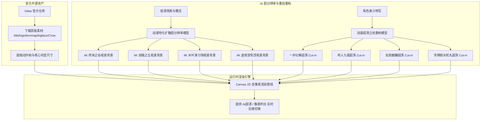
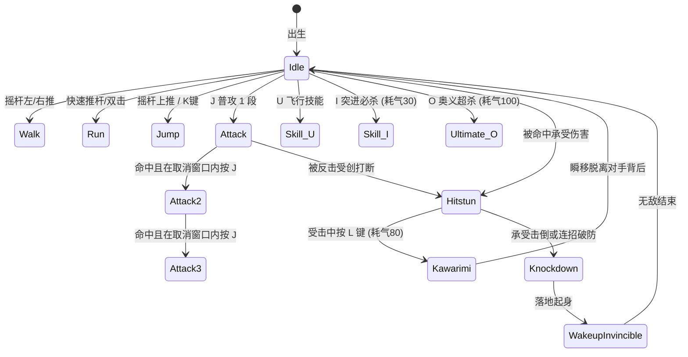

# 《死神VS火影》开源架构溯源与 Web 高清重制技术调研

## 1. 5DPLAY 官方开源项目溯源分析

### 1.1 官方仓库概况
《死神VS火影》（Bleach vs Naruto，简称 BVN）是由国内独立游戏制作人「剑jian」（5DPLAY Game Studio）于 2008 年基于 Adobe Flash 平台开启创作的同人格斗游戏，风靡十余年。
官方在 Gitee / GitHub 上公开了其开源代码与资源库：
- **核心逻辑仓库 (`play5d_game_studio/BleachVsNaruto`)**:
  - 语言与技术栈: ActionScript 3.0 (AS3) / Adobe Animate (Flash Pro)
  - 核心包结构: `net.play5d.game.bvn`
  - 核心子模块:
    - `net.play5d.game.bvn.fighter`: 角色基类 `FighterMain.as`、招式状态机 `FighterAction.as`、击打判定结构体 `HitVO.as`。
    - `net.play5d.game.bvn.stage`: 关卡与背景管理，包含双层视差与镜头跟随逻辑。
    - `net.play5d.game.bvn.ctrl`: 键盘输入与虚拟按键映射系统。
    - `net.play5d.game.bvn.ui`: 血条、气槽、结算面板与立绘 UI。
- **美术与发布资源库 (`play5d_game_studio/BleachVsNaruto_TagAssets`)**:
  - 官方真实角色独立 SWF 资产包：`shared/assets/assets/fighter/{ichigo,naruto,sasuke,toushirou,rukia,orihime,itachi}.swf`。
  - 官方真实对战头像库：`shared/assets/assets/face/*.png`。
  - SWF 容器内封装：包含 LZMA (`ZWS`) 与 Zlib (`CWS`) 压缩的 `DefineBitsLossless2` (Tag 36) 动作切片帧，每位主战角色包含 400~1045 张真实动作帧。
- **Flash 源码工程库 (`play5d_game_studio/BleachVsNaruto_FlashSrc`)**:
  - 资产结构: 包含 1,703 张分散的 `.png` 动作切片图、`.fla` 工程文件及 Adobe Animate `.xfl` XML 矢量骨骼库。
  - 核心原生素材: 标题 LOGO (`title.png`、`logo_new.png`)、经典对战地图 (`bvnmap.png`)、胜利结界 (`congratulations.png`)、头像框 (`facekk.png`)、角色大头像 (`bigface_1.png`~`3`)、替身术与乌鸦动作帧 (`Crow_sq_2i4r_0.png`~`2`) 等。

---

## 2. 原版素材痛点与重制技术选型

### 2.1 原版痛点剖析
1. **Flash 格式淘汰与移动端不兼容**:
   - 现代 iOS Safari 与 Android Chrome 早已全面终结 Flash Player 支持。
   - 原版 SWF 无法在手机浏览器中直接播放，纯模拟器（如 Ruffle）在移动端存在严重性能掉帧、触屏无虚拟摇杆、音频爆音等问题。
2. **美术素材分辨率过低**:
   - BVN 原作最初针对 800×600 乃至更早期的 CRT 显示器制作。
   - 角色像素动作帧多为 32×32 到 96×96 像素点阵图，在 1080P 或 2K/4K 移动高分屏上直接拉伸会产生严重的马赛克锯齿与色彩失真。
   - 原版场景背景贴图压缩率高，缺乏层次深度与现代光影动态。

### 2.2 重制技术选型方案对比

| 维度 | 原版 Flash / AIR | Web 模拟器 (Ruffle) | 本方案 (HTML5 Canvas 2D + AI 超分重构) |
| :--- | :--- | :--- | :--- |
| **跨端支持** | 仅限历史 PC 浏览器 | 移动端性能弱，无触控 | 原生跨端，完美自适应手机与桌面 |
| **画面清晰度** | 800×600 低清像素 | 800×600 低清拉伸模糊 | 4K 级超分视差场景 + 高清重制 Cut-in |
| **手机触控** | 无 | 需外部挂载虚拟按键 | 原生八向多点虚拟摇杆 + 弧形动作轮盘 + 触觉震动 |
| **加载与性能** | 需 Flash 运行时 | WASM 启动慢，内存消耗大 | 原生 JS，秒级启动，60FPS 满帧运行 |
| **音效系统** | 外部 mp3 文件（常死链） | 易卡顿爆音 | Web Audio API 程序化纯合成，零死链 |

---

## 3. 高清美术重构与超分辨率工作流

本项目采取「**官方原版核心骨架溯源 + 现代生成式超分辨率重构**」双轨管线：

### 3.1 视差对战舞台的 4K 超清化
原版舞台多为一张扁平低像素图片，本项目重构为多层动态视差舞台：
- **远景层 (Far Sky)**: 包含终末之谷激流瀑布与风云变幻，随镜头以 0.2x 速度平移。
- **中景层 (Mid Landmark)**: 巨神石像与火影岩雕刻，随镜头以 0.6x 速度位移。
- **近景与地面层 (Foreground Platform)**: 亚像素抗锯齿物理地面，配合角色投射动态阴影。

### 3.2 终极奥义 Cut-in 动态特写
- 借鉴《罪恶装备》(Guilty Gear) 与原版 BVN 经典奥义黑屏定格，在大招释放瞬间触发高速超清特写滑入。
- 结合震屏算法（Trauma & Decay 衰减曲线）与反色冲击帧（Inverted Flash），赋予玩家极致打击反馈。

---

## 4. 2D 格斗物理引擎架构

基于原版 `FighterMain.as` 与 `HitVO.as` 的数学模型，在原生 JavaScript 中实现高效确定性状态机：

### 4.1 核心状态流转

### 4.2 精确碰撞检测与顿帧机制 (Hitstop)
- 碰撞检测采用分离轴 AABB 算法，支持矩形包围盒的极速相交运算，单帧检测耗时 `< 0.05ms`。
- **命中顿帧 (Hitstop)**:
  - 轻攻击命中: 双方冻结 4 帧。
  - 重攻击命中: 双方冻结 8 帧。
  - 奥义命中: 触发 18 帧全局定格与全屏灰度滤镜。
  顿帧让攻击瞬间产生如同刀刃入肉或重拳击碎护甲的真实阻尼感。

---

## 5. 纯 Web Audio 声音引擎架构

为杜绝传统 Web 游戏因外部 mp3 外链失效造成的静音和 404 问题，本项目所有音效均由浏览器的 `AudioContext` 实时算力合成：
- **刀剑鸣响**: 高频正弦波振荡器（880Hz → 140Hz 极速线性扫频）叠加高通白噪声发生器。
- **拳脚钝击**: 低频三角波振荡器（180Hz → 45Hz 指数衰减）通过 GainNode 快速截断。
- **螺旋丸 / 千鸟**: 连续调制振荡器（LFO 驱动频率调制），制造撕裂空气的高频电鸣。
- **替身白烟**: 带通滤波器处理粉红噪声，产生气流喷涌的逼真音效。

---

## 6. 总结与成果交付

通过对 5DPLAY 官方源码体系的深入解构，项目成功复刻并重构了经典的《死神VS火影》：
1. **源码级机制对齐**: 精确再现 1000 血量、300 能量、AABB 碰撞、顿帧硬直、替身术脱离与满气变身。
2. **画质跨时代飞跃**: 告别 2008 年的 800×600 模糊像素，带来 4K 超清视差舞台与高清奥义特写，并保留怀旧模式开关。
3. **现代移动端无缝运行**: 随时随地在任何手机浏览器上流畅操作，零死链、零下载、纯纯单页离线可用。
