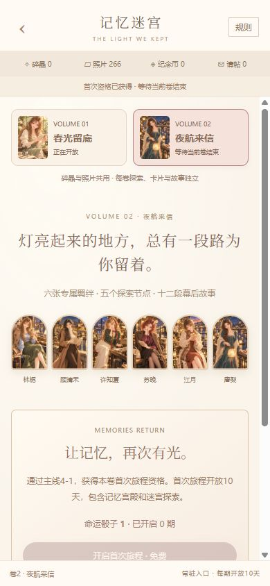

# 记忆迷宫卷二 · 夜航来信

日期：2026-10-12。版本：`20261012-labyrinth-volume2-2`。本轮增加第二个可玩的原创卷册，同时把记忆迷宫改成多卷数据结构；整款游戏目标继续进行。

## 内容与视觉

男主仍为成年制作人沈屿。卷二发生在夜间纪录片收工以后，以车票、河岸灯光、录音和回家的路串起六位成年女生的故事。采用奶油、柔粉、木色和琥珀灯光，人物保持静态精美立绘；不恢复此前已经暂停的Live2D制作。

| 角色 | 羁绊 / 编号 | 品质 | 独立服装与场景 |
| --- | --- | --- | --- |
| 林栀 | 灯下新芽 / 126 | SR | 蓝色针织、驼色外套、绿裙，夜间列车窗边 |
| 顾清禾 | 灯河有岸 / 127 | SSR | 米色高领、驼色长外套，河桥下展开地图 |
| 许知夏 | 未眠电台 / 128 | SSR | 深绿衬衣、酒红丝巾、浅色长裤，夜间录音室 |
| 苏晚 | 末班来信 / 129 | SR | 梅紫系带衬衣、棕色外套、眼镜，站台读信 |
| 江月 | 暖夜双份 / 130 | SSR | 奶油外套、陶土色针织裙、围巾，河岸夜摊 |
| 唐梨 | 沿河星光 / 131 | SR | 青绿色长裙、浅色披肩、侧辫，河边提灯 |

六张均由内置imagegen逐张生成并查看。原始PNG与WebP各存一份在项目assets；每张1024×1536，使用SVG等比裁切，没有横纵独立拉伸，也没有拿卷一卡面充作新卡。完整提示词与素材位置见[卡面记录](warm-signal-labyrinth-night-art-prompts.md)。全游戏现有132张卡、540个手机条目；新卡各关联4个手机条目，获取/星级/进化门槛沿用现有系统。新卡不进入普通许愿池。

## 卷册与资源

1. 卷册页可切换春光留底、夜航来信。未达门槛也能预览卡面；卷一主线2-12、卷二主线4-1各获得一次免费首次旅程资格。门槛是本项目安排。
2. 同时只开放一卷，每期10天。另一卷可以预览；按钮明确提示等待当前卷结束，并提供返回正在开放卷册的操作。切换视图不终止或延长活动。
3. 两卷共用无垢碎晶、泛黄照片和命运骰子。剩余资源可带入下一卷，抽取和兑换扣共用余额。每卷分别记录收入、支出和回忆历史，以核对共享钱包。
4. 每卷的专属卡碎片、首开180张请帖、剩余请帖、五节点探索/补次数/星级、进度、纪念币、补给商品限额、故事阅读与里程碑领奖分别保存。不能借用另一卷的纪念币或请帖。
5. 探索加成仅统计当前卷已经拥有的六张专属卡，重复卡只计一次；其他卷专属卡不带来本卷加成。三张实际阵容、公司能力和纪录专家照常决定是否通关。
6. 照片兑换SSR碎片每片32、SR每片9；SSR80片、SR50片合成。宫殿四张回忆的等概率组合规则不变。卷二的普通回忆道具换成夜航车票、河岸纸灯、录音磁带。
7. 每卷复刻消耗共用骰子1枚，只重开宫殿与照片换卡碎片，不重开探索、不重发请帖、不恢复商品限额。票房商店月度兑换规则不变。
8. 图鉴的获取入口跳到卡片所属卷。已有碎片可在归档期合成；即使当前查看另一卷，也按该卡自己的卷册检查。已解锁故事、纪念币兑换与历史记录继续可用。

## 卷二探索与故事

| 节点 | 重点能力索引 | 目标 | 基础进度 / 币 |
| --- | --- | --- | --- |
| 开往晚风的车票 | 0、3 | 1000 | 14 |
| 绕远的一盏灯 | 0、2 | 1500 | 15 |
| 零点之后的频率 | 1、3 | 2100 | 16 |
| 站台上的留白 | 1、2 | 2700 | 17 |
| 有岸可归的夜航 | 2、3 | 3300 | 18 |

每节点初始5次成功探索机会，每次体力5。两星可扫荡，请帖优先补次数，没有请帖时每次5钻石。失败只耗体力。

新增十二段、144句原创剧情，每位女生两段：灯下新芽/迟到的站名、不必走直线/河的另一边、未播出的点歌/零点后的回声、末班来信/可以留到明天、两块饼干的距离/锅里的星星、纸灯往哪里走/没有观众的夜航。与卷一合计288句，文本全部不同。按进度80、220、420、640、880、1160、1460、1800、2200、2640、3120、3600解锁，逐句保存，已读免费重温。进度4000领金币120000，4500领许愿券10，各限一次。卷二补给为金币1500/30币/40份、心愿6/18币/25份、体力40/40币/10份。

## 存档与验证

记忆迷宫存档升至v3：根节点保存共享钱包、唯一开放期和当前查看卷；books数组分别存两卷进度。旧v1/v2先按原规则验证，再迁入卷一；卷二补空记录，不自动发卡、照片、请帖或奖励，不延长旧开放期。旧验证器独立保留，正式玩家无需重开存档。

共享收入/支出等于两卷账本之和，碎晶余额等于购买总数减抽取总数，照片余额等于收入减支出。每卷校验碎片来源与合卡、回忆结果/历史、探索额度、进度上下界、商品限额、阅读门槛及领奖。每卷最近开启时间与根开放卷对应，避免换掉活动卷编号绕过检查。切换卷册提高操作版本，旧确认弹窗不得扣款；回拨时间、过期请求、重复确认和不足余额全部先拒绝再结算。

新增15项多卷行为测试；全量649项通过，详见[suite日志](warm-signal-screenshots/labyrinth-volume2-full-tests.txt)。覆盖旧v2迁移、各卷门槛/首次免费/互斥窗口、资源跨卷使用与独立进度、稀有度碎片差异、新卡合成与手机解锁、图鉴跨卷合成、独立加成、旧弹窗失效、卷二五节点/十二故事/两里程碑全流程、复刻和畸形导入。104个JS文件及检查页内联脚本语法通过，主游戏140个、检查页138个本地目标全部存在，35份样式继续使用。静态检查另存[结果](warm-signal-screenshots/labyrinth-volume2-static-check.json)。

正式浏览器旧存档迁移后仍为钻石10637、金币89602、照片266、卷一纪念币100、请帖175、骰子1、探索143、五节点三星；卷一原截止10/22 00:38保留。选择卷二刷新仍保留，显示等待当前卷结束；没有提前结束玩家旅程或改时间。卷二完整试玩放在不写玩家存档的独立检查页，通过正常游戏API生成场景：卷一归档→卷二免费首开→十次回忆合成林栀SR126→请帖与探索。浏览器进一步实际兑换碎晶1、顾清禾回忆1次，照片1600→1680、碎片0→5；故事目录进度198与卷一110独立。独立场景使用固定随机值，属于行为验证，不代表随机实抽分布。

390×844检查正式卷二六卡预览、宫殿与故事；320×740检查商城，文档宽320、滚动区宽305且内容宽305，无横向溢出，六图均为2:3等比显示，浏览器错误/警告为空。

## 研究与边界

沿用此前实际查看过的历史宫殿/双入口/五节点界面，以及[官方组合概率页](https://evol.papegames.cn/news/8)、[2021台服公告转载](https://forum.gamer.com.tw/Co.php?bPage=0&bsn=33645&sn=14512&subbsn=3)和[2020常驻介绍](https://wap.gamersky.com/news/Content-1288652_2.html)。官方概率支持四种回忆独立抽取；多历史卷、互斥开放和跨期保留资源来自历史运营资料，地区安排有差异。本轮重新访问前两页未取得正文，因此没有把本次抓取失败当作新增证据；原始研究记录仍在此前策划中。

夜航来信是成年女性角色、男主视角的原创卷，不使用原作人物、剧情或美术。主线门槛、剧情阈值、商品、命运骰子月度安排与数值为项目适配。当前完成两卷；原作全部历史卷、全部活动、专业完整配音、线上运营和整款游戏所有细节尚未完成，不能称为完美复刻。
